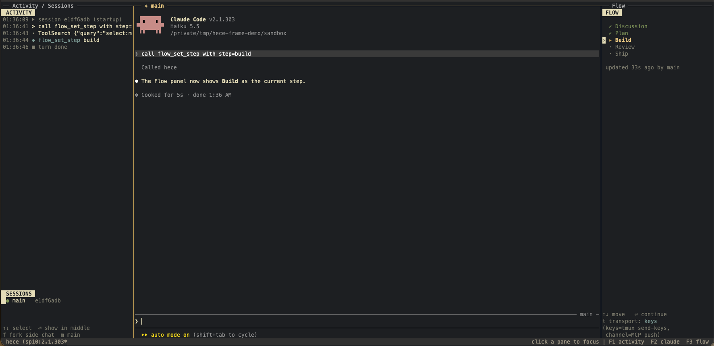

# hece

[](https://github.com/harungokcegoz/hece/actions/workflows/ci.yml)
[](LICENSE)
[](https://github.com/harungokcegoz/hece/discussions)

**Stay in the loop while AI agents build.**

*hece* is Turkish for "syllable". *Hecelemek* means to spell a word out syllable by syllable. hece does that to features: it breaks them into pieces small enough to understand, discuss and defend.

> **Status: early (v0.1).** `hece` opens one terminal window: Activity on the left, Claude Code in the middle, your flow on the right. The panels are read-only for now. See the [roadmap](#roadmap).



<sub>**Early prototype from the feasibility spike.** The shipped window keeps the three panes: Activity on the left, the real Claude Code unchanged in the middle, and the Flow panel on the right showing the current step. Claude moved the flow to *Build* by calling hece's MCP server.</sub>

---

## Why

AI coding agents keep getting better, and they'll keep getting better. They're built and measured on one thing: **finishing the task**. Every improvement makes them more autonomous. They ask fewer questions, stop less, and hand you bigger finished chunks. That's great for output. For the person who has to own the code, it's a slow problem.

Many of us have moved from *building with* agents to *watching them build*. Features ship and tests pass. Afterwards you can't answer *how did you connect A to B?*, *what is the flow?* or *why this approach?* Plans and explanations arrive in chunks too big to digest, so approval becomes trust instead of understanding. Over the years that turns into skill atrophy: you can describe what you want, but you can't build, debug or defend it.

The agent isn't the problem. It's doing exactly what it was made for. Nothing in it is designed to keep *you* involved. As agents get more capable, the builders who want to stay real builders need the opposite of more autonomy: **more involvement**. That means:
- discussing decisions instead of receiving them;
- seeing each step instead of the final diff;
- understanding the code well enough to defend it.

hece puts you back in the loop without giving up the agent. It changes the pace and the size of what you hand over, not the model.

## What it does

- **Discussion first.** It works like talking with a senior: one decision per turn, you propose, the agent proposes, and either side pushes back with reasons.
- **Chunked plans.** Each slice is one behavior you can see working, touching about 1–3 files.
- **A stop after every slice.** The agent explains what changed and how it connects, point first, with real names and a diagram when it helps. Then it waits for you.
- **Guards** (optional, on by default). Code enforces the two rules that matter: no edits before you approve the plan or while a slice waits for you, and the agent can't approve its own work.
- **Check questions** (optional). One skippable question per slice about the wiring.
- **Review and recap** (optional). A fresh reviewer walks you through findings one at a time, then you get an A → B → C recap of the flow.
- **Delegate** (optional). A strong model discusses, plans and reviews; cheaper models build slices.

```
discuss ─▶ plan ─▶ build: [ slice 1 ─▶ slice 2 ─▶ … ] ─▶ review ─▶ recap ─▶ done
                          each slice: working ─▶ stopped ─▶ approved (by you)
```

**Prompts ask, code enforces.** Judgment and style live in markdown skills. Anything that would break your trust if it failed lives in code:

```
skills (markdown)  ── how to behave: pacing, explanations, diagrams, pushback
hece hook          ── runs on every tool call: blocks edits while you're needed,
                      records your approval ("continue" or the picker)
hece mcp           ── the agent reports progress: phases, decisions, slices
.hece/state/       ── plain files; `hece status` shows exactly what hece believes
```

## Requirements

- [Claude Code](https://claude.com/claude-code)
- The [superpowers](https://github.com/obra/superpowers) plugin. hece builds on its brainstorming, planning, subagent and review skills:
  ```
  /plugin install superpowers@claude-plugins-official
  ```
- Node.js 20 or newer
- [tmux](https://github.com/tmux/tmux) for the three-pane window (`brew install tmux` on macOS). Without it, `hece` still works, just without panels.

## Quick start

Download `hece-<version>.tgz` from the [latest release](https://github.com/harungokcegoz/hece/releases/latest). It already contains the compiled CLI and its dependencies, so there is nothing to install or build. Unpack it and point Claude Code at the folder:

```bash
tar -xzf hece-<version>.tgz        # creates ./hece
claude --plugin-dir ./hece
```

For the `hece` command (panels and the window), run `npm link` inside the unpacked folder.

**From source:**

```bash
git clone https://github.com/harungokcegoz/hece.git
cd hece && npm install && npm run build && npm link
```

Then, in any project:

```bash
cd your-project
hece
```

`hece` opens the window. The **Activity** panel tells you what Claude is doing in plain words ("Now: saving only a hash of the token…", "changing src/auth/reset.ts", "running the tests"), and the **Flow** panel shows where you are. Use `hece --no-frame` for Claude Code with hece but without panels. Inside an existing tmux session, or when piping (`hece -p …`), hece runs without panels automatically. On a narrow terminal the side panels are dropped so Claude keeps enough room. Running `hece` again reattaches to the open window (arguments only apply when a new window opens).

It accepts the same arguments as `claude`, for example `hece -c` to continue your last session.

The first time you run `hece` in a terminal, a short setup asks how involved you want to be. Esc skips it and uses the defaults. You can come back any time:

```bash
hece setup         # choose your preferences again
hece prefs [name]  # change one group, e.g. hece prefs guards
hece doctor        # check the install
```

Ask Claude to build something with hece, for example *"Let's build a CLI that prints a greeting, using hece."* To see where you are, run this from your project root:

```bash
hece status
```

To approve the plan or a slice, type `continue` (or `ok`, `next`, `go`, `approve`), or pick **Continue** in the picker.

## Build modes

After you approve the plan, hece asks three questions in one picker:

- **Mode:** `One by one` (default) or `Parallel`.
- **Model** for the build subagents (first option is `delegate.build`).
- **Effort:** `medium`, `low` or `high`.

Model and effort are asked every time and not stored. The main chat never edits code: every slice is built by a subagent, told to use your `optimize` pack and superpowers TDD.

- **One by one:** one slice, one stop, one approval.
- **Parallel:** independent slices run at the same time. Slices that touch the same files run one after another. You get one report for the whole batch. Type `continue` to approve all of it (typing it while slices still run does nothing), or `redo 2 4` to send specific slices back.

`optimize` picks a pack the subagents use: `ponytail` or `caveman`. If it isn't installed, hece says so and carries on without it.

```
/plugin marketplace add DietrichGebert/ponytail
/plugin install ponytail@ponytail

/plugin marketplace add JuliusBrussee/caveman
/plugin install caveman@caveman
```

Caveman turns itself on at SessionStart and SubagentStart, so it also affects the main chat once installed. hece can't switch that off, but its flow skill says hece:communicate wins for every message to you.

## Without the CLI: the portable skill

You don't use Claude Code, or don't want to install anything? [`portable/staying-in-the-loop/SKILL.md`](portable/staying-in-the-loop/SKILL.md) is the same approach as a single, brand-neutral skill file for any chat or agent app. It covers the discussion, small slices, a stop after every slice, how you approve, explanations with diagrams, review and recap.

- **Apps that support skills** (Claude Code, Codex, Gemini CLI and others): copy the `portable/staying-in-the-loop/` folder into your skills directory, e.g. `~/.claude/skills/` or `~/.agents/skills/`.
- **Any other app** (ChatGPT, Claude.ai projects, Cursor rules, …): paste the contents of `SKILL.md` into the custom instructions, project instructions or rules file.

Without hece's hooks, the rules are kept by the agent itself (soft guards) and not enforced by code. For hard guards, use the CLI.

## Preferences

`~/.config/hece/preferences.yaml` holds your global defaults; `hece setup` and `hece prefs` write it for you. `.hece/preferences.yaml` in a project overrides them and can be committed to share a setup with your team.

```yaml
preset: involved            # involved | learning | custom
slice_stop: { depth: short } # line | short | detailed
check_questions: off        # off | non-routine | every
flow_recap: false
review: { final: on, reviewer_model: opus, show_minor: false }
delegate: { orchestrator: default, build: sonnet, review: opus }
guards: { stops: on, files: on } # old `guards: on|off` still works
effort: { orchestrator: default, build: medium, review: high }
optimize: ponytail          # ponytail | caveman
```

`delegate.orchestrator: default` leaves the model Claude Code is already using. `effort` sets how hard each role thinks.

A typo like `gaurds: off` is reported by name, and the safe default (guards on) stays.

## Agent support

| Agent | Status | Guards | Delegate |
|---|---|---|---|
| Claude Code | **v0.1** | hard (hooks) | subagents with a model per slice |
| Codex CLI | planned | soft unless hooks exist | decided in its adapter spec |
| Gemini CLI | planned | soft unless hooks exist | decided in its adapter spec |
| OpenCode | planned | soft unless hooks exist | decided in its adapter spec |

See [`adapters/`](adapters/). Contributions for other agents are very welcome.

## Roadmap

1. **Core engine** ✅: state, flow, preferences, guards, hook, MCP server, skills, Claude Code plugin.
2. **Frame:** ✅ the three-pane window with plain-language Activity and the live Flow (2a). Next (2b): panel keys that talk to Claude (Enter = continue), side chats, and arrow navigation.
3. **Onboarding:** `hece setup`, `hece prefs`, `hece doctor`.
4. **Release:** bundled plugin install (no build step), npm package, more agents.

The design is in [`docs/superpowers/specs/`](docs/superpowers/specs/) and the implementation plans are in [`docs/superpowers/plans/`](docs/superpowers/plans/).

## Privacy

hece sends nothing anywhere. Its state lives in `.hece/state/` inside your project, which hece adds to `.gitignore` automatically.

## Contributing

Questions and ideas are welcome in [Discussions](https://github.com/harungokcegoz/hece/discussions); bugs and concrete features go in [issues](https://github.com/harungokcegoz/hece/issues/new/choose). Looking for a place to start? Try a [good first issue](https://github.com/harungokcegoz/hece/labels/good%20first%20issue).

See [CONTRIBUTING.md](CONTRIBUTING.md). Please read the [Code of Conduct](CODE_OF_CONDUCT.md). Report security issues as described in [SECURITY.md](SECURITY.md).

## License

[MIT](LICENSE) © Harun Gökçegöz
